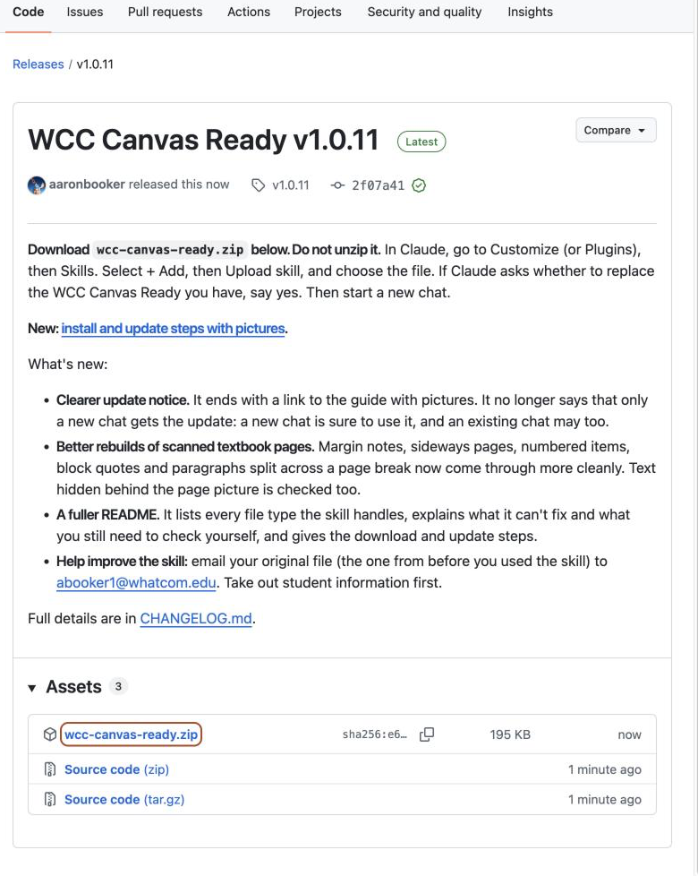
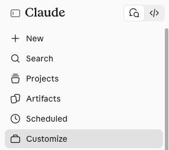
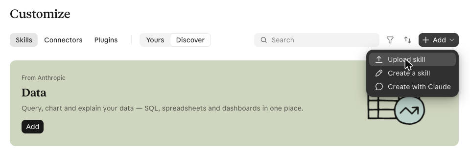
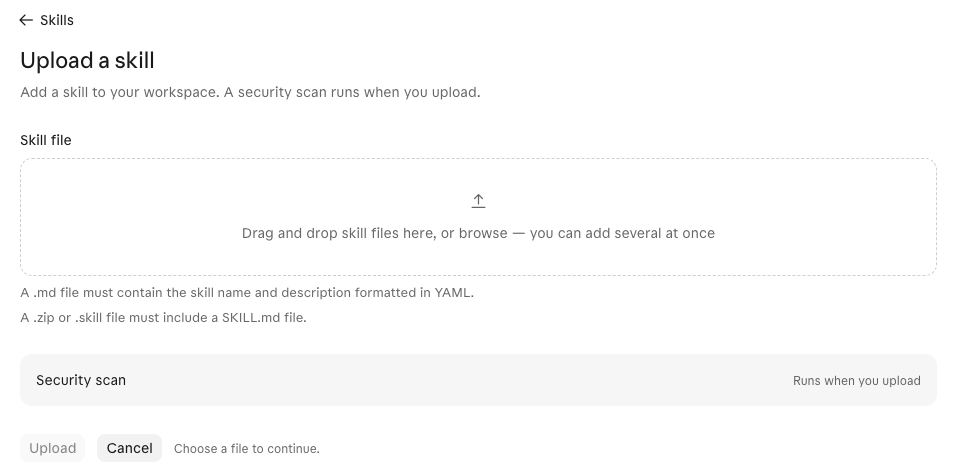
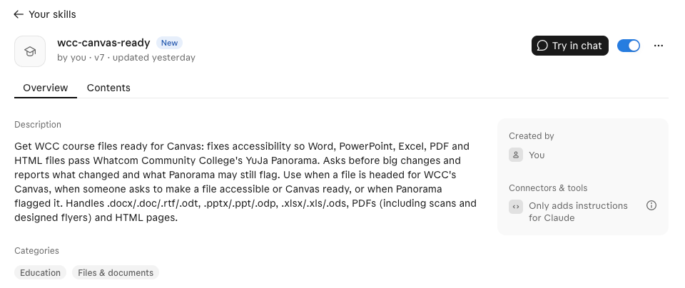

# Install or update WCC Canvas Ready, step by step

These steps work for a first install and for every update. They use Claude in a web browser at [claude.ai](https://claude.ai). A free Claude account works. Each update takes about a minute.

Claude changes its menus often. These pictures were taken on November 18 and 19, 2026, and your screen may look a little different.

## Get updates from here

The skill keeps improving, and updates may come often. Every update comes from this GitHub site. When there is a newer version, the skill tells you at the start of a chat, names the new version and gives you a link back here. Claude can't install the update for you, so you follow the steps below.

The notice looks like this. This one came from the update to version 1.1.0.

Only download the skill from [github.com/aaronbooker/wcc-canvas-ready](https://github.com/aaronbooker/wcc-canvas-ready). If an email, a message or another website offers you a WCC Canvas Ready file, don't use it.

## Before you start (first install only)

1. Make a Claude account at [claude.ai](https://claude.ai) if you don't have one.
2. In Claude, select your name in the bottom-left corner, then **Settings**, then **Capabilities**.
3. Make sure **Create and edit files** is switched on. Skills need it.

## Step 1: Download the ZIP file

1. Open the [latest release of WCC Canvas Ready](https://github.com/aaronbooker/wcc-canvas-ready/releases/latest). The version number is at the top, next to a green **Latest** label. A short list of what's new is below it.
2. Under **Assets**, select **wcc-canvas-ready.zip**. Don't choose either **Source code** download. Those won't work in Claude.
3. Leave it as a ZIP file. Don't open or unzip it.

**On a Mac with Safari:** Safari may unzip the file on its own. If you see a folder named wcc-canvas-ready instead of a ZIP file, download it again in Chrome. Or, in Safari, open **Settings**, then **General**, turn off **Open "safe" files after downloading**, and download it again.

## Step 2: Upload it to Claude

1. In Claude's left sidebar, choose **Customize**. Claude is renaming this to **Plugins**, so you may see that name instead.

   

2. Make sure **Skills** is selected at the top. Choose **+ Add**, then **Upload skill**.

   

3. Drag **wcc-canvas-ready.zip** from your Downloads folder into the box, or select **browse** and choose it. Then select **Upload**. Claude runs a quick security scan.

   

4. **Updating?** If Claude asks whether to replace the WCC Canvas Ready you have, say yes. You don't need to delete the old one first.

## Step 3: Check that it's on

Open **wcc-canvas-ready** in your list of skills. Check that its switch, at the top right, is on.

## Step 4: Start a new chat

The new version is sure to work in a new chat. To check, type: **Use the WCC Canvas Ready skill and tell me which version it is and whether there is an update.** The version should match the one on the GitHub page.

To use the skill, attach a file with the **+** button (or drag it into the chat box) and type **Get this file ready for Canvas.** Take out student names, grades and records first.

## Help improve the skill

Send your original file, the one from before you used the skill, to Aaron Booker at [abooker1@whatcom.edu](mailto:abooker1@whatcom.edu). That's all: no report and no second file. Aaron runs it through the skill himself, and the files faculty send are how the skill gets better. Take out student names, grades and records first. Files you send are used only for testing and are not shared or posted.

---

© 2026 Aaron Booker. This guide is licensed under [Creative Commons Attribution 4.0 International (CC BY 4.0)](https://creativecommons.org/licenses/by/4.0/). Screenshots show Claude (Anthropic) and GitHub as they appeared on November 18 and 19, 2026.
