# Install or update WCC Canvas Ready, step by step

These steps cover a first install and every update. They use Claude in a web browser at [claude.ai](https://claude.ai). A free Claude account works. An update takes about a minute.

Claude changes its menus often. The pictures of Claude were taken on November 21, 2026, and your screen may look a little different.

## Get updates from here

The skill keeps improving, and updates may come often. Every update comes from this GitHub site. When there is a newer version, the skill tells you at the start of a chat, names the new version and gives you a link back here. Claude can't install the update for you, so you follow the steps below.

The notice looks like this. This one came from the update to version 1.1.0. Notices from later versions name the .skill file.

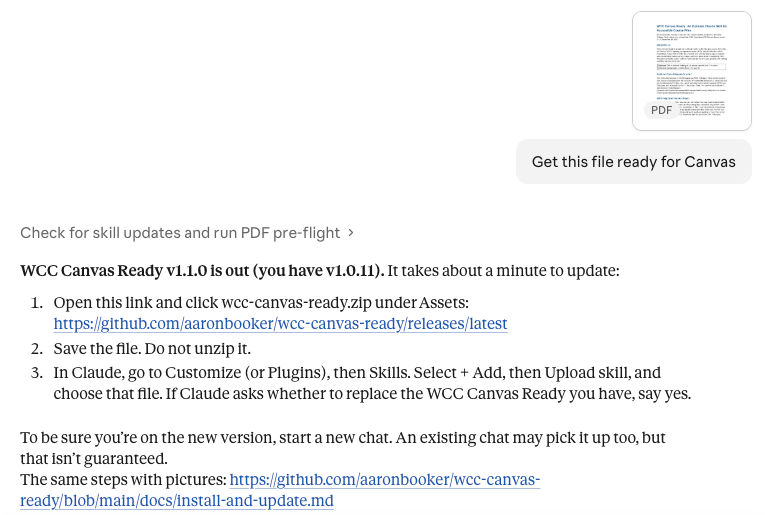

Only download the skill from [github.com/aaronbooker/wcc-canvas-ready](https://github.com/aaronbooker/wcc-canvas-ready). If an email, a message or another website offers you a WCC Canvas Ready file, don't use it.

## Before you start (first install only)

1. Make a Claude account at [claude.ai](https://claude.ai) if you don't have one.
2. In Claude, select your name in the bottom-left corner, then **Settings**. Settings opens in a window over your chat. Choose **Capabilities** in the list on the left.
3. Make sure **Create and edit files** is switched on. Skills need it.

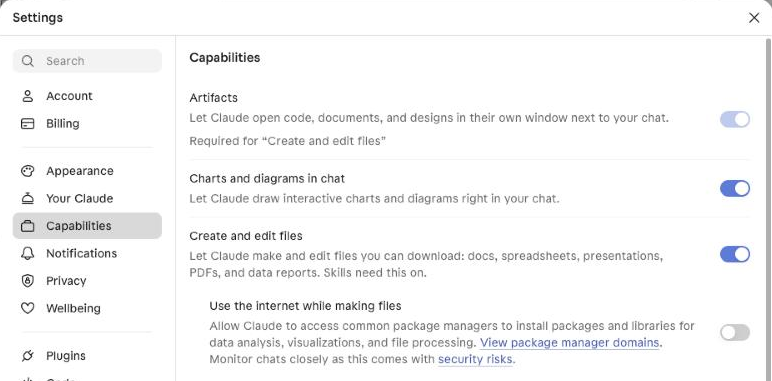

## Step 1: Download the .skill file

1. Open the [latest release of WCC Canvas Ready](https://github.com/aaronbooker/wcc-canvas-ready/releases/latest). The version number is at the top, next to a green **Latest** label. A short list of what's new is below it.
2. Under **Assets**, select **wcc-canvas-ready.skill**. Don't choose either **Source code** download. Those won't work in Claude.
3. It goes into your Downloads folder. Leave it as it is. Don't open it.

The release may also list **wcc-canvas-ready.zip**. It's the same skill in the older file type. Use the .skill file: Claude's **Upload new version** button accepts only that.

## Step 2: Add it to Claude (first install)

1. In Claude's left sidebar, choose **Plugins**.

   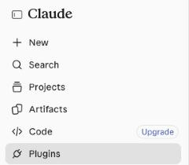

2. At the top right of the Plugins page, choose **Add**, then **Upload plugin**. Claude treats a skill as one kind of plugin, so this is the right choice.

   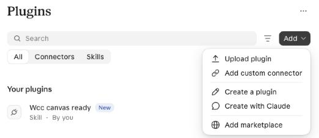

3. On the **Upload a plugin** page, drag **wcc-canvas-ready.skill** from your Downloads folder into the box under **Plugin file**, or select **browse** and choose it. A **Preview** shows the skill's name and description. Then select **Upload**.

   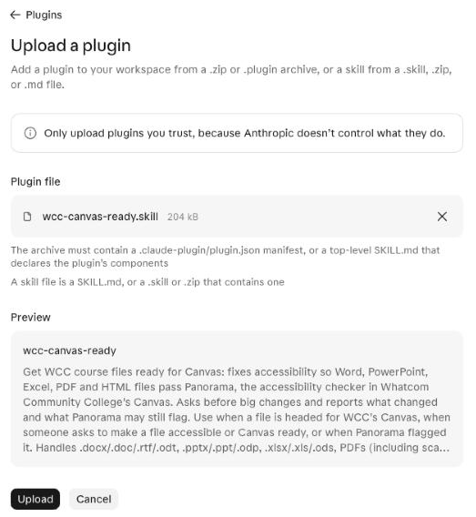

4. Claude says **Wcc canvas ready is added and ready to use.** The skill is listed under **Your plugins** on the Plugins page. Open it and check that it says **Added** at the top right. A blue **New** label may show next to its name.

   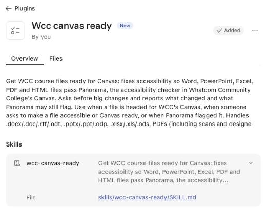

## Step 2 instead: Update the copy you have

1. In Claude's left sidebar, choose **Plugins**. Under **Your plugins**, open **Wcc canvas ready**.
2. Select the three dots (**…**) at the top right, then **Upload new version**.

   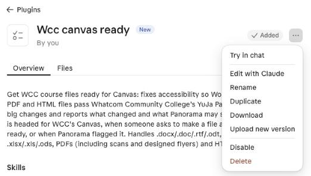

3. Drag **wcc-canvas-ready.skill** into the box, or select **Browse files** and choose it. Then select **Upload**. It replaces the old version. You don't need to delete anything first.

   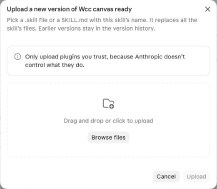

4. Claude says **Replaced Wcc canvas ready**.

   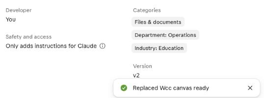

The **Version** on that page (v1, v2 and so on) only counts how many times you've uploaded the skill. It isn't the skill's version number. Step 3 shows how to check that.

If you choose **Add**, then **Upload plugin** for an update by mistake, that works too. Claude asks **Replace existing plugin?** Select **Replace**.

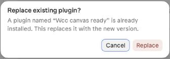

## Step 3: Start a new chat

The new version is sure to work in a new chat. To check, type: **Use the WCC Canvas Ready skill and tell me which version it is and whether there is an update.** The version should match the one on the GitHub page.

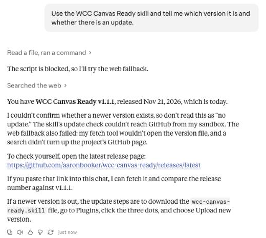

On many accounts Claude can't reach GitHub to check for updates. Then it tells you which version you have and gives you the link, and you can compare the number yourself.

To use the skill, select the **+** button and choose **Upload or add files** (or drag your file into the chat box), then type **Get this file ready for Canvas.** Take out student names, grades and records first.

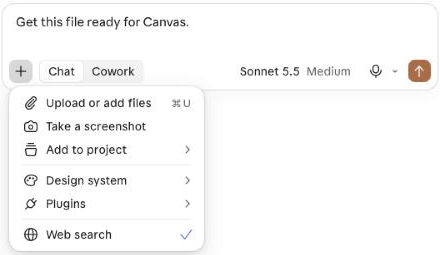

## Help improve the skill

Send your original file, the one from before you used the skill, to Aaron Booker at [abooker1@whatcom.edu](mailto:abooker1@whatcom.edu). That's all: no report and no second file. Aaron runs it through the skill himself, and the files faculty send are how the skill gets better. Take out student names, grades and records first. Files you send are used only for testing and are not shared or posted.

---

© 2026 Aaron Booker. This guide is licensed under [Creative Commons Attribution 4.0 International (CC BY 4.0)](https://creativecommons.org/licenses/by/4.0/). Screenshots show Claude (Anthropic) and GitHub as they appeared on November 19, 20 and 21, 2026.
